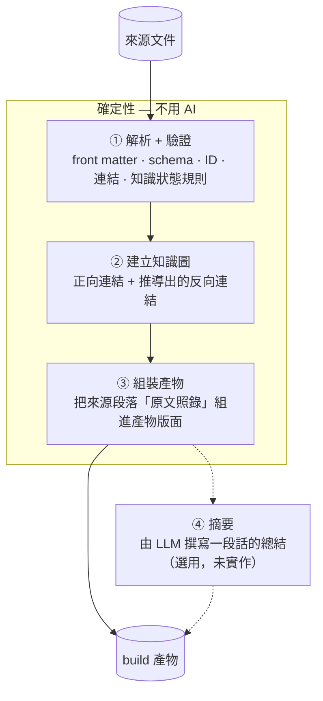

# Build

> **為維護而寫，為閱讀而 build。**

知識文件依負責人與生命週期拆分：需求在這裡，規則在那裡，決策和 API 合約又在別處。這對*維護*知識是對的，對*閱讀*知識卻是錯的。不應該有人得從 REQ 追到 BR、ADR、API，才能拼湊出一個功能的全貌。

軟體業早就解決了這個問題：原始碼為了可維護性而拆開，再由 build 產出人真正使用的東西。本儲存庫用同樣的方法處理知識：

| 軟體 | 這個知識系統 |
|---|---|
| 原始碼（為了維護而拆開） | REQ、BR、ADR、API… |
| 型別／介面定義 | [`templates/metadata.yaml`](templates/metadata.yaml) |
| import／依賴關係圖 | `related` 連結 |
| linter + 測試 | `npx kb validate` + [文件健康 Agent](agents/documentation-health-agent.md) |
| **編譯器** | **`npx kb build`** |
| **build 產物（`dist/`）** | **功能總覽、QA 清單、AI context、變更紀錄、健康報告** |
| source map | 每個產生的段落都連回來源文件與版本 |
| 有錯就 build 失敗 | 斷裂連結、schema 錯誤、權威外洩會讓 build 失敗 |

---

## 安裝

在使用本框架的專案（例如 knowledge repo）裡，以 devDependency 從 git 安裝，版本用 tag 鎖定，跟安裝其他 npm 套件一樣：

```bash
npm install -D git+https://github.com/samchliu/living-kb.git#v0.1.0
npx kb validate
```

升級 = 改 tag 再 `npm install`。不需要架 npm registry，也不需要 Python。公司內網連不到 GitHub 時，把本 repo 鏡像到內部 GitLab，網址換成鏡像即可。

---

## 快速上手

```bash
npx kb validate                 # 檢查 docs/
npx kb build                    # 先檢查，再產生 docs/_build/
npx kb trace BR-001             # BR-001 跟哪些東西有關？

# 用範例試試看
npx kb build --src examples/pos-recommendation --today 2026-09-16
```

需要 Node 18.17 以上，沒有任何第三方依賴。在使用本框架的專案裡，以 devDependency 安裝（見下方「安裝」）；在框架 repo 本身，`npx kb` 直接可用。

---

## build 產物的五條規則

1. **絕不編輯產物。** 要改就改來源，再重新 build。每個產物開頭都有「自動產生，請勿編輯」字樣。
2. **產物永遠不是事實來源。** 若與來源文件不一致，以來源為準。產物開頭會寫明這一點。
3. **每個段落都有 source map。** 連回它來自的文件、段落、狀態與日期。
4. **產物記錄自己的輸入。** 「來源」一行列出所有來源文件及其 `updated` 日期。來源改了，產物就過期了，重新 build 即可。
5. **有錯誤就 build 失敗。** 斷裂連結或 schema 錯誤被視為編譯錯誤，而不是建議。

## 流程



**為什麼 ①–③ 完全不用 AI：** build 必須可重現，LLM 做不到。因此規則、參數、驗收條件、API 欄位一律**原文引用，絕不改寫**。被改寫過的規則，就是一條看起來很權威、卻沒人審查過的新規則。之後若要加入第 ④ 步，請只讓 LLM 撰寫明確標示的摘要段落，絕不能讓它產出規則、數字或合約本身。

`kb` 是確定性的：同樣的來源加上同樣的 `--today`，產出的內容會逐位元組相同。它不會嵌入 build 時間戳記。

---

## 指令

| 指令 | 做什麼 | 退出碼 |
|---|---|---|
| `validate` | 檢查 `--src` 下的所有文件並印出報告 | 有錯誤時為 `1`（加上 `--strict` 時，有警告也為 `1`） |
| `build` | 先執行 `validate`；通過後重新產生輸出目錄 | 驗證失敗時為 `1`，且不寫出任何檔案 |
| `trace ID` | 印出上游（▲ 為什麼存在）與下游（什麼依賴它） | ID 不存在時為 `1` |
| `config` | 印出合併後的設定，以及各層的套用順序 | 設定有錯時為 `2` |
| `seal ID` | 封存紀錄性文件（REF/CLR/RPT）：寫入內文與附檔的 sha256。已封存且內容變動時**拒絕**，除非加上 `--reseal`（由人決定） | 拒絕時為 `1` |
| `add-ref 檔案… --title T [--source S] [--owner O]` | 把外部資料登記為 REF：複製到 `docs/reference/_originals/REF-nnn/`、產生 `REF-nnn.md`、立即封存 | 失敗時為 `1` |

所有指令在設定檔有錯誤（未知的鍵、試圖修改不變式、extends 循環或不存在）時，都會以 `2` 結束且不做任何檢查。

| 選項 | 預設 | 意義 |
|---|---|---|
| `--config FILE` | `./kb.config.yaml`，其次是 `tools/` 旁的那份 | 專案設定檔。見下方「設定與 profile」。 |
| `--src DIR` | 設定檔的 `src`，否則 `docs/` | 知識目錄，會遞迴掃描（`.` 或 `_` 開頭的資料夾除外）。兩種組織方式都可以：依類型（`docs/business-rules/`）或依功能（`docs/features/<名稱>/`）。 |
| `--out DIR` | `<src>/_build` | 輸出目錄。每次都會刪除後重建，但只有在含有 `.kb-build` 標記時才會刪除。 |
| `--today YYYY-MM-DD` | 今天 | 過期檢查使用的日期。在 CI 等場合固定它，輸出就能重現。 |
| `--code-root DIR` | — | 程式碼儲存庫根目錄，啟用針對程式碼的檢查（見下方）。 |
| `--strict` | 關閉 | 把警告也視為錯誤。 |
| `--lang en\|zh-TW` | 設定檔的 `lang` | 輸出語言。 |

---

## 設定與 profile

`kb.config.yaml` 讓同一套框架套用到不同團隊：公司專案 `extends` 公司 profile（UI 規範、CI 流程），個人專案 `extends` `personal` profile（放寬核准與審查節奏）。完整說明見 [`profiles/README.md`](profiles/README.md)，所有可用的鍵見根目錄的 [`kb.config.yaml`](kb.config.yaml)。

```yaml
# <專案>/kb.config.yaml
extends:
  - kb:small-team                           # kb 內附的 profile
  - ../org-standards/profiles/frontend      # 組織自己的 profile：目錄（讀 profile.yaml）或 .yaml 檔
review_days:
  api: 30                                   # 專案層覆蓋 profile
```

| 合併規則 | |
|---|---|
| 順序 | 內建預設 → extends 的 profile（遞迴、由左到右）→ 本檔。同一個 profile 被引用兩次只套用一次 |
| map | 逐鍵合併 |
| list | 聯集；`key!:` 改為取代 |
| 純量 | 後面的層覆蓋前面 |
| 不能設定 | 類型、知識狀態、status、關係、證據規則；`required_fields` 只能附加 |

`ai_context.instructions` 會附加到每份 AI context 的「指示」清單；`ai_context.include` 列出的 Markdown 會整份嵌入「團隊／組織規範」章節。這是讓組織規範真的被 AI 讀到的地方。

---

## `validate` 檢查什麼

`validate` 執行的是文件健康 Agent 檢查中**確定性的部分**。需要判斷力的部分仍然交給 Agent。

| 嚴重程度 | 類別 | 檢查 |
|---|---|---|
| 錯誤 | `SCHEMA` | 缺少必填欄位；未知的 `type`／`status`／`knowledge_state`／`confidence`／`rel`；ID 前綴與類型不符；知識狀態與類型不符；日期格式錯誤；探索性文件的 `source_of_truth` 不是 `none`；後設資料無法解析 |
| 錯誤 | `DUPLICATE` | 兩份文件使用同一個 ID |
| 錯誤 | `BROKEN_LINK` | `related`、`supersedes` 或 `superseded_by` 指向不存在的 ID |
| 錯誤 | `CONFLICT` | **權威外洩**：權威文件透過 `derived_from`／`relates_to` 以外的關係依賴探索性或紀錄性知識 |
| 錯誤 | `IMMUTABLE` | 已封存紀錄的附檔 sha256 不符、附檔被加入或移除、CLR/RPT 內文被修改 |
| 錯誤 | `BROKEN_LINK` | 紀錄 `files` 中的檔案不存在；CLR `落地到` 指向不存在的 ID |
| 警告 | `STALE` | `last_reviewed` 超過 `review_every`；`derived_from`／`implements`／`governed_by` 的目標在最後審查後有變更；RPT 驗證的目標在量測日後有變更 |
| 警告 | `MISSING` | 生效中的 `needs_approval` 類型沒有 `approved_by.who`；BR 沒有 `verified_by` 測試；REQ 沒有驗收條件；CR 超過 `cr_open_days` 未決定；REF 或已結案的 CLR/RPT 未封存；CLR 已回覆卻未落地、結案時仍有 open、超過 `clarification_open_days` 未結案 |
| 警告 | `ORPHAN` | REQ 沒有 `derived_from`；BR 不是源自任何 REQ；API/ARCH 沒有 `implements` |
| 警告 | `OWNERSHIP` | 負責人是 `AI`，或不是 `OWNERSHIP.md` 中的角色 |

**加上 `--code-root` 時：**

| 嚴重程度 | 類別 | 檢查 |
|---|---|---|
| 警告 | `DRIFT` | `implemented_in`／`verified_by` 的路徑在程式碼中不存在 |
| 警告 | `ORPHAN` | 程式碼引用了不存在，或已棄用／封存的 ID |
| 警告 | `CONFLICT` | 程式碼引用了探索性知識（`PROTO-…`、`FB-…`、`EXP-…`） |
| — | 涵蓋率 | QA 清單會逐條規則回報：已連結的測試是否提到它（`BR-001#R3`、`test_BR_001_R3_…`） |

**仍然交給 AI Agent 的部分：** 程式碼的*行為*是否符合規則（語意上的偏移）、兩份用文字撰寫的文件是否互相矛盾、測試是否真的涵蓋了邊界條件，以及影響分析。`validate` 能在每個 PR 上低成本地抓出結構性問題，讓 Agent 專心處理需要判斷力的問題。

---

## build 產物

```text
<out>/
  README.md                         索引：功能列表、健康狀態、所有來源
  health.md                         所有 validate 發現，附連結
  changelog.md                      所有文件的變更歷史，新到舊
  features/
    REQ-001/
      overview.md                   一頁看完整個功能
      qa-checklist.md               驗收條件 + 規則範例（核取方塊）+ 測試涵蓋
      ai-context.md                 AI 程式助理實作時需要的一切
```

每個未棄用、未封存的需求都會產生一個功能資料夾。

| 產物 | 讀者 | 組成內容 |
|---|---|---|
| **功能總覽** | PM、新同事、老闆 | REQ（問題、目標、使用者、範圍、限制、驗收條件）→ BR（規則、參數、理由）→ ADR（決策、取捨）→ ARCH（概觀、元件）→ API（端點、請求、回應、錯誤）→ 程式碼／測試路徑 → 未解問題、CR、健康檢查結果 → 探索性背景（僅連結）→ 合併後的變更紀錄 |
| **QA 測試清單** | QA、PM 驗收 | REQ 驗收條件 + 所有 BR 範例，轉成核取方塊；各規則的測試涵蓋 |
| **AI context** | Claude Code 等 AI 程式助理 | **只含權威知識**：範圍、驗收條件、規則、參數、範例、決策、架構、API、程式碼路徑、負責人、未解問題，外加指示（回報偏移、不要捏造、不要猜未解問題）；設定檔的 `ai_context` 規範；相關 REF 的原文連結（僅供查證，規格以權威文件為準） |
| **變更紀錄** | 所有人 | 所有變更歷史與 ADR 備註，依日期排序 |
| **健康報告** | 負責人 | `validate` 的所有發現 |

### 哪些文件屬於同一個功能

build 從需求出發，雙向追蹤連結。它絕不會走進**其他需求**或產品背景，所以共用的規則不會把不相關的功能拉進來。它也絕不會*穿過* **探索性文件或變更申請**繼續往外走：這些文件只會被列出，不會被展開。

### 探索性知識在產物中的位置

探索性文件**只**出現在總覽的「背景」章節：只列連結，標明「是證據，不是規則」，內容絕不嵌入。AI context 則完全排除它們。沒有這條規則，build 就會變成原型假設外流進規格的管道。

---

## 產物放在哪裡

| 階段 | 做法 |
|---|---|
| **起步** | 需要時在本機執行 `build`。`docs/_build/` 已加入 `.gitignore`。 |
| **之後** | CI 在每個 PR 執行 `validate`（有錯誤就不能合併），在主分支執行 `build`，並把 `_build/` 發布成內部網站（GitLab Pages 需先轉成 HTML，見下方說明）。 |
| **絕不** | 在真實專案中 commit `_build/`。遲早會有人改產物而不是改來源，兩者就開始不一致。 |

> 範例專案 commit 了 `examples/pos-recommendation/_build/`，**僅作為**展示輸出長什麼樣子的樣本。

最小 CI 設定（GitLab CI，放在 knowledge repo 的 `.gitlab-ci.yml`）：

```yaml
image: node:22

knowledge:validate:
  stage: test
  script:
    - npm ci
    - npx kb validate          # 待處理項目清完後再加上 --strict
  rules:
    - if: $CI_PIPELINE_SOURCE == "merge_request_event"
    - if: $CI_COMMIT_BRANCH == $CI_DEFAULT_BRANCH

knowledge:build:
  stage: deploy
  script:
    - npm ci
    - npx kb build
  artifacts:
    paths: [docs/_build/]
  rules:
    - if: $CI_COMMIT_BRANCH == $CI_DEFAULT_BRANCH
```

> `_build/` 是 Markdown。GitLab Pages 不會把 Markdown 轉成網頁，所以目前先以 CI artifact 保存；要讓 PM 直接用瀏覽器閱讀，還需要一個轉成 HTML 的步驟（規劃在 `kb init` 中一起提供）。

框架 repo 本身的 CI 另外加一個 job 跑 `npm test`；使用框架的專案不必跑。

---

## build 對來源文件的要求

- **後設資料使用 YAML 子集：** `key: value`、巢狀 map、區塊列表、行內 `[a, b]` 與 `{k: v}`、引號、`#` 註解。這就是 `templates/metadata.yaml` 用到的全部語法。不支援 anchor、多行字串等進階 YAML；解析錯誤會直接回報，不會用猜的。
- **保留範本的段落標題。** build 依標題名稱找段落（`## 規則`、`## 驗收條件`…），中英文都接受。可以加後綴（`## 規則（v2）`），但把 `## 規則` 改名成 `## 邏輯`，build 就看不到那個段落了。
- **支援濃縮檔案。** 沒有 front matter 的檔案可以包含多筆紀錄，每筆是一個 `## 標題` 加上一個含 `id` 的 ```` ```yaml ```` 區塊，例如 `examples/pos-recommendation/feedback.md`。
- **輸出格式定義在 `src/build.js` 中**，沒有另外的範本檔。腳本是產物版面的唯一來源，所以不會有範本和腳本不同步的問題。

---

## 修改 `kb` 時

```bash
npm test                               # node:test，零依賴，約 1 秒
```

[`tests/kb.test.js`](tests/kb.test.js) 涵蓋五件事：

| 範圍 | 保證 |
|---|---|
| 回歸 | 範例專案 build 出的內容與 commit 的 `examples/pos-recommendation/_build/` 逐位元組相同；build 可重現 |
| 設定 | 合併規則（map／list／純量／`!`）、相對路徑、diamond 只套用一次、不變式不可設定、各種錯誤以 `2` 結束、內附 profile 可載入 |
| 紀錄 | `add-ref`、封存與竄改偵測、拒絕替變動背書、權威文件只能以證據關係引用紀錄、CLR 與 RPT 的檢查 |
| 範本 | 紀錄類範本可被解析，且類型與知識狀態正確 |
| CLI | 參數錯誤以 `2` 結束、`--help`、`--option=value` 寫法、無效日期 |

**刻意改變了 build 輸出時**（例如調整版面），golden test 會失敗。確認新輸出正確後，重新產生樣本：`npx kb build --src examples/pos-recommendation --today 2026-09-16`。
