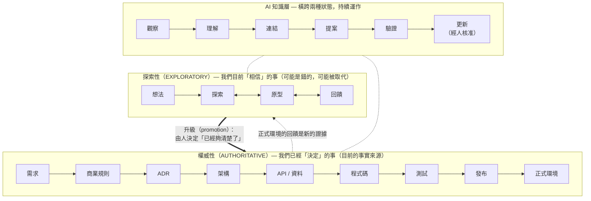

# AI 原生・活的知識系統（AI-Native Living Knowledge System）

一套給小型產品團隊（例如 **1 位 PM + 1 位 RD**）的輕量起手式。適合用 AI 開發產品、需求每週都在變的團隊。

這**不是**一套文件框架，而是一個**知識生命週期**：少量彼此連結的文件由人負責，AI 持續閱讀、連結、驗證，並協助維持它們的正確性。

---

## 本儲存庫的三個核心理念

> **文件不是開發完成後才產出的靜態成品。**
> **它是產品、系統、決策與正式環境行為持續演進的知識模型。**

> **AI 不是知識的負責人。**
> **AI 是一層持續理解、連結、驗證，並協助維護「由人負責的知識」的機制。**

> **原型不一定是需求的產出物。**
> **在 AI 輔助的產品開發中，原型可以是「發現需求」的工具。**

本儲存庫的其他一切，都由這三句話推導而來。

---

## 60 秒看懂整個模型



- **兩種知識狀態。** `exploratory`（探索性）知識——想法、原型、回饋——允許是錯的。`authoritative`（權威）知識——需求、商業規則、ADR、API 合約——是團隊明確接受為「此刻的事實」的知識。一份文件絕不會悄悄地從一種狀態變成另一種。
- **由人負責知識領域。** PM 負責「做什麼、為什麼」；RD 負責「怎麼做」。負責人（Owner）對正確性負責；任何人（包括 AI）都可以撰寫。**負責人 ≠ 撰寫者。**
- **AI 負責維護。** 它起草、建立連結、偵測過期／衝突／缺漏／偏移的知識、分析變更影響並提出更新建議。它**不會**核准商業或架構決策，也絕不會自行把探索性知識升級為權威知識。
- **關係是一等公民。** 每份文件都宣告它與哪些知識相關，因此「如果 BR-001 改了，會影響什麼？」這類問題有真正的答案。
- **為維護而寫，為閱讀而 build。** 知識拆成小文件，是為了方便維護。build 步驟（`kb` 指令）會把它們組成可以直接閱讀的頁面：每個功能各有一份總覽、一份 QA 清單和一份給 AI 實作用的 context，不需要任何人手動拼湊。

---

## 儲存庫地圖

```text
README.md                  ← 你在這裡：理念 + 快速上手
PRINCIPLES.md              ← 所有規則背後的 13 條原則
WORKFLOW.md                ← 探索迴圈、工程迴圈、AI 知識層
OWNERSHIP.md               ← 誰負責哪個知識領域（請先填這份）
BUILD.md                   ← 來源 → build：驗證、追溯、產生可閱讀的產物

bin/kb.js, src/            ← kb 指令（Node 18.17+，零依賴；npm 套件）
package.json               ← 讓專案用 npm 安裝本框架
tests/                     ← kb 的測試（npm test）
kb.config.yaml             ← 專案設定：extends profile、路徑、節奏（見 profiles/）
profiles/                  ← 可疊加的團隊規範：company-frontend、personal

docs/                      ← 你的專案的「活知識」放這裡
  README.md                ← 知識地圖：資料夾、ID、關係模型
  _build/                  ← 由 `npx kb build` 產生（已加入 git ignore，絕不編輯）
  exploration/             ← EXP、PROTO、FB      （探索性）
  product/                 ← 產品背景             （權威，PM）
  requirements/            ← REQ、CR             （權威，PM）
  business-rules/          ← BR                  （權威，PM）
  architecture/            ← ARCH                （權威，RD）
  decisions/               ← ADR                 （權威，決策者）
  api/                     ← API、資料合約        （權威，RD）
  operations/              ← OPS 維運手冊         （權威，RD / DevOps）
  reference/               ← REF 外部參考資料     （紀錄性，原文封存不得更動）
  records/                 ← CLR 待確認清單、RPT 報告（紀錄性，結案後封存）

templates/                 ← 建立新文件時複製這些範本
  metadata.yaml            ← 通用後設資料規格（請讀一次）

policies/                  ← AI 與人共同遵守的規則
agents/                    ← 5 個 AI Agent 的規格（尚未實作）
examples/pos-recommendation/ ← 完整生命週期：從「老闆有個想法」到上線後的變更
```

---

## 文件類型

刻意精簡。大多數功能只需要其中三到四種。

| 類型 | ID 前綴 | 知識狀態 | 預設負責人 | 存放位置 | 範本 |
|---|---|---|---|---|---|
| 探索 | `EXP` | 探索性 | PM | `docs/exploration/` | `templates/exploration.md` |
| 原型 | `PROTO` | 探索性 | PM | `docs/exploration/` | `templates/prototype.md` |
| 回饋 | `FB` | 探索性（證據） | PM | `docs/exploration/` | `templates/feedback.md` |
| 產品背景 | `PROD` | 權威 | PM | `docs/product/` | 僅需後設資料標頭 |
| 需求 | `REQ` | 權威 | PM | `docs/requirements/` | `templates/requirement.md` |
| 變更申請 | `CR` | 權威（決策紀錄） | PM | `docs/requirements/` | `templates/change-request.md` |
| 商業規則 | `BR` | 權威 | PM | `docs/business-rules/` | `templates/business-rule.md` |
| 架構 | `ARCH` | 權威 | RD | `docs/architecture/` | `templates/architecture.md` |
| 架構決策紀錄 | `ADR` | 權威 | 決策者 | `docs/decisions/` | `templates/adr.md` |
| API／資料合約 | `API` | 權威 | RD | `docs/api/` | `templates/api.md` |
| 維運 | `OPS` | 權威 | RD / DevOps | `docs/operations/` | 僅需後設資料標頭 |
| 外部參考 | `REF` | 紀錄性（原文不得更動） | 收件人 | `docs/reference/` | `npx kb add-ref`／`templates/reference.md` |
| 待確認清單 | `CLR` | 紀錄性（結案後封存） | 提問人 | `docs/records/` | `templates/clarification.md` |
| 報告 | `RPT` | 紀錄性（定稿後封存） | 產出人 | `docs/records/` | `templates/report.md` |

每份文件都以相同的 YAML 後設資料標頭開始——見 [`templates/metadata.yaml`](templates/metadata.yaml)。有兩個欄位絕對不能混淆：

- `knowledge_state`：**exploratory**（探索性，我們相信的）、**authoritative**（權威，我們決定的）或 **record**（紀錄性，某個時間點發生的事：收到的資料、問過的問題、量測的結果）——*我們該多信任它？*
- `status`：**draft → review → approved → active → deprecated → archived**——*這份文件處於生命週期的哪個階段？*

---

## 快速上手（2 人團隊，約 30 分鐘）

1. **填寫 [`OWNERSHIP.md`](OWNERSHIP.md)。** 把 `@pm` 和 `@rd` 換成真實的人。5 分鐘。
2. **安裝 PR 範本。** 把 `templates/pr-template.md` 複製到程式碼儲存庫的 `.gitlab/merge_request_templates/Default.md`（GitHub 則是 `.github/pull_request_template.md`）。
3. **下次有人說「我想要 X」時**，不要寫 PRD。用 `templates/exploration.md` 建立 `EXP-001`，寫下這個想法和你的假設。
4. **讓 AI 做原型。** 記錄為 `PROTO-001`。拿給人看。把反應記錄為 `FB-001`。反覆循環。
5. **夠清楚時就升級。** 請需求探索 Agent 產出一份*候選*需求。PM 編修並核准為 `REQ-001`。把「必須一直成立」的規則抽出來寫成 `BR-*`。
6. **RD 只為「值得留下理由」的決策寫 ADR**——也就是未來的同事可能會問「為什麼要這樣做？」的決策。
7. **執行 build。** `npx kb build` 會檢查所有文件，並產生 `docs/_build/`：每個需求各有一份單頁總覽、一份 QA 清單和一份 AI 實作 context。把 AI context 交給你的程式助理，而不是讓它自己猜。見 [`BUILD.md`](BUILD.md)。
8. **每週一次**，再執行文件健康 Agent 處理需要判斷力的檢查：把 [`agents/documentation-health-agent.md`](agents/documentation-health-agent.md) 交給有儲存庫存取權的 AI 助理，並根據報告處理。

接著閱讀範例：[`examples/pos-recommendation/`](examples/pos-recommendation/README.md)。它展示了完整生命週期——一個模糊的想法、三個原型、從回饋中浮現的需求、上線後被要求的規則變更，以及 AI 如何追蹤其影響。

---

## 本儲存庫刻意**沒有**的東西

- 沒有簽核流程工具。「已核准」的意思是*負責人在 PR 審查中同意了*，文件中記錄是誰、何時核准。
- 沒有幾十種文件類型。如果你想新增一種，請改成在現有文件中加一個段落。
- 沒有強制會議。審查發生在工作原本就發生的地方：PR 裡，以及與利害關係人一起看原型的時候。
- 不要求每個變更都產出文件。修錯字不產出任何東西；規則變更只需要在 BR 中改一行並留下歷史紀錄。

偏好 **少量文件類型 + 清楚的負責人 + 強關聯 + AI 驗證**，而不是**文件官僚體系**。

---

## 本儲存庫目前狀態

這是 **知識架構 + 範本 + 治理基礎**，再加上一個最小的 **build 工具**。

- **已實作：** `kb` 指令（Node，`src/`），一個確定性、零依賴的工具，負責驗證文件、追溯關係，並 build 出可閱讀的產物。它涵蓋了可追溯性 Agent 與文件健康 Agent 中機械性的部分。
- **只有規格、尚未實作：** 五個 AI Agent。`agents/` 中的每份規格都寫成今天就能直接當作指示交給任何有儲存庫存取權的 AI 程式助理使用，之後也能實作為自動化檢查（CI 工作、機器人、排程任務）。

> 本文件為繁體中文版。英文原版位於 `../ai-native-living-knowledge-system/`。文件 ID、YAML 欄位名稱與列舉值（如 `status: active`）刻意保留英文，以便 AI Agent 與工具解析。
