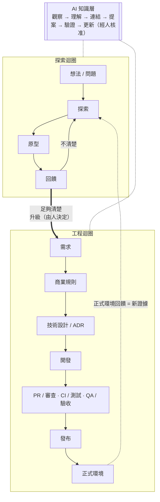
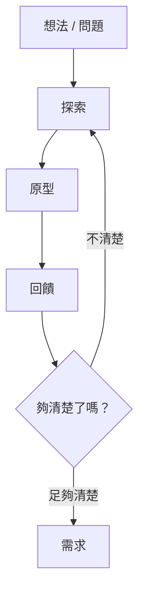
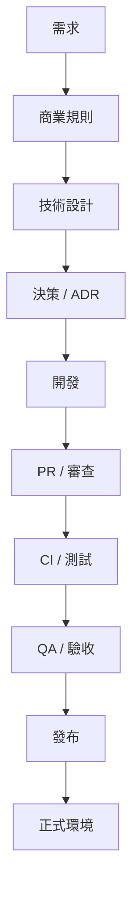
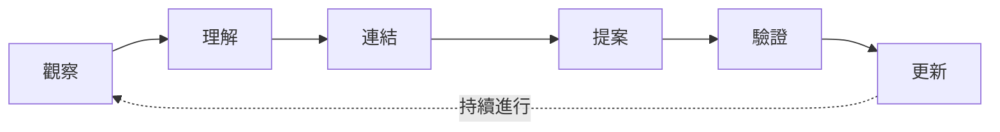
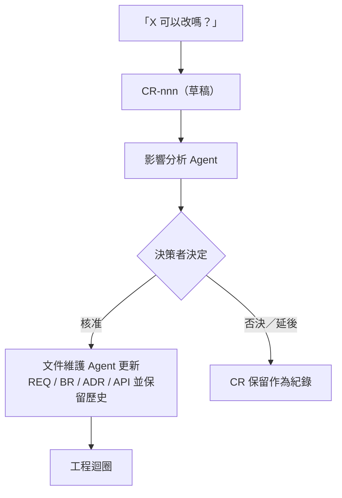

# 工作流程

兩個迴圈，加上一層：

1. **探索迴圈（Discovery Loop）**——把模糊的想法變成清楚的需求。產出*探索性*知識。
2. **工程迴圈（Engineering Loop）**——把需求變成可運作的軟體。產出並使用*權威*知識。
3. **AI 知識層（AI Knowledge Layer）**——橫跨兩個迴圈、持續運作，讓知識保持連結且正確。



---

## 1. 探索迴圈



這個迴圈明確承認：**需求可能是透過原型迭代而浮現的**。老闆說「我想要 AI 推薦」不是需求，而是一次探索的起點。

| 步驟 | 誰 | 產出 | AI 的角色 |
|---|---|---|---|
| 記下想法 | PM | `EXP-nnn`：想法、問題假設、未知事項 | 從對話、會議紀錄或語音備忘錄起草 EXP。把*陳述的事實*和*假設*分開。 |
| 做原型 | PM（與 AI） | `PROTO-nnn` + 原型本身（HTML、Figma、簡報…） | 產生原型。列出原型中暗藏的每一個假設。標示哪些是假的／模擬的。 |
| 展示並傾聽 | PM | `FB-nnn`——誰說了什麼，以及你的詮釋 | 整理原始筆記。標出與先前回饋或現有假設矛盾的回饋。 |
| 決定要改什麼 | PM | 更新 EXP（假設、信心程度、演進歷史），可能產生新的 `PROTO` | 建議回饋支持或削弱了哪些假設。**絕不**把回饋直接變成規則。 |
| 確認清晰度 | PM（+ RD） | 決定：再跑一輪，或升級 | 執行需求探索 Agent：候選需求、候選規則、未解問題、衝突、信心程度。 |

### 什麼時候算「足夠清楚」？

以下**全部**成立時就升級。這是 PM 的判斷——不是審查委員會。

- [ ] 利害關係人已經看過原型，並確認核心流程（「對，這就是我要的」）。
- [ ] 你能寫出測試人員可以檢查的驗收條件。
- [ ] 沒有任何「答案會改變*範圍*」的未解問題（細節層級的問題可以留著——列出來就好）。
- [ ] 需求所依賴的每個假設，都已確認，或已明確接受為已知風險。
- [ ] RD 看過了，沒有「這做不到／比你想的貴 10 倍」的反對意見。

### 升級（Promotion）

升級是兩種知識狀態之間唯一的橋樑，而且**永遠是人的行為**：

1. AI（或 PM）起草候選的 `REQ-nnn` 和 `BR-nnn`，`status: draft`。
2. 草稿中的每個主張都引用其證據（`derived_from` → EXP / PROTO / FB）。
3. PM 編修、刪掉實際上還沒決定的部分，然後核准（`status: approved`，填寫 `approved_by`）。
4. EXP 標記為 `confidence: confirmed`，之後改為 `status: archived`。它**不會**被刪除，也**不會**被改寫成需求——我們如何走到這一步的歷史要保持可讀。

文件的 `knowledge_state` 永遠不會翻轉。升級是建立**新的**權威文件並連結回探索性文件。見 [`policies/knowledge-lifecycle.md`](policies/knowledge-lifecycle.md)。

---

## 2. 工程迴圈



| 階段 | 使用的知識 | 產出／更新的知識 | 負責人 | AI 的角色 |
|---|---|---|---|---|
| 需求 | EXP、PROTO、FB | `REQ` | PM | 檢查驗收條件是否可測試；標出缺漏及與既有 BR 的矛盾。 |
| 商業規則 | REQ | `BR` | PM | 抽出 REQ 隱含的規則；提出範例與邊界情境；詢問例外。 |
| 技術設計 | REQ、BR、既有 ARCH | `ARCH`（新增或更新段落） | RD | 起草設計；列出受影響元件；找出限制它的既有 ADR。 |
| 決策 | ARCH 草稿 | `ADR`（僅限值得留下理由的決策） | 決策者 | 起草背景／替代方案／取捨；絕不替人做決定。 |
| 開發 | BR、ADR、API | 程式碼、`API` 規格 | RD | 實作；在程式碼與測試中引用知識 ID（見下方）。 |
| PR / 審查 | 所有連結的知識 | 含「相關知識」與「文件影響」的 PR 描述 | RD（BR 變更時 + PM） | 檢查 PR 範本是否誠實：diff 是否動到了文件卻沒更新的東西？ |
| CI / 測試 | BR、REQ 驗收條件 | 測試 | RD | 把測試對應到 BR 與驗收條件；回報未測試的規則。 |
| QA / 驗收 | REQ 驗收條件 | 驗收結果（寫在 REQ 變更歷史或發布說明） | PM | 從 REQ 產生驗收檢查清單。 |
| 發布 | REQ、CR | 發布說明 | RD | 摘要本次發布改變了哪些知識。 |
| 正式環境 | OPS、ARCH | `OPS`、新的 `FB` | RD / PM | 把事故與使用者反應整理成 `FB`——下一輪的證據。 |

### 輕量的「程式碼 ↔ 知識」連結

在程式碼註解與測試名稱中使用知識 ID。幾乎零成本，卻讓偏移偵測變得非常簡單（`grep -r BR-001`）。

```python
# knowledge: BR-001 (recommendation rules), ADR-001 (rule-based scoring)
def score_restock_candidates(...):
    ...

def test_BR_001_R3_max_five_recommendations_per_store(): ...
```

反方向則寫在文件的後設資料中：

```yaml
related:
  - path: services/recommendation/scoring.py
    rel: implemented_in
  - path: tests/recommendation/test_scoring.py
    rel: verified_by
```

---

## 3. AI 知識層



| 步驟 | 發生什麼事 |
|---|---|
| **觀察（Observe）** | 留意變化：新增／編輯的文件、PR、合併的程式碼、測試結果、發布、正式環境回饋。 |
| **理解（Understand）** | 閱讀變更與它碰到的知識。區分探索性與權威知識。 |
| **連結（Connect）** | 更新或提議 `related` 連結。找出上游的理由與下游的依賴。 |
| **提案（Propose）** | 起草最小幅度的文件更新、變更申請或新文件。一律以提案形式。 |
| **驗證（Validate）** | 檢查過期、衝突、孤立、缺漏、偏移或無人負責的知識。 |
| **更新（Update）** | 權威知識：負責人核准**後**才套用。連結、錯字、摘要，以及負責人要求的探索性草稿：可直接套用。 |

**監看對象：** 想法 · 探索 · 原型 · 需求 · 商業規則 · 架構 · ADR · API · 程式碼 · 測試 · 發布 · 正式環境 · 回饋

**偵測項目：** 過期知識 · 衝突知識 · 孤立知識 · 缺漏知識 · 斷裂的關聯 · 實作／文件偏移 · 歸屬問題 · 變更影響

[`agents/`](agents/) 中的五個 Agent 分工如下：

| Agent | 典型觸發時機 | 產出 |
|---|---|---|
| [需求探索](agents/requirement-discovery-agent.md) | 「我們可以寫需求了嗎？」 | 候選 REQ/BR + 未解問題 + 信心程度 |
| [文件維護](agents/documentation-maintainer.md) | 一個 PR、一個決策，或要求更新文件 | 最小幅度、保留歷史的文件 diff |
| [可追溯性](agents/traceability-agent.md) | 「程式為什麼這樣做？」／「BR-001 由誰實作？」 | 穿越知識圖的追溯路徑 |
| [影響分析](agents/impact-analysis-agent.md) | 變更申請或提議中的變更 | 受影響的知識、程式碼、測試、風險 |
| [文件健康](agents/documentation-health-agent.md) | 每週，或每個 PR | 健康報告：STALE / ORPHAN / DRIFT / MISSING / CONFLICT / OWNERSHIP |

---

## 4. 當範圍改變時



當變更會碰到**已核准**的 REQ、BR、ADR 或 API 合約時——或之後有人會問「這是誰決定的？」時——就寫 CR。還在探索迴圈裡的變更不需要 CR，那只是回饋。見 [`policies/change-policy.md`](policies/change-policy.md)。

---

## 5. 日常節奏

不新增會議。知識工作附著在你原本就在做的事情上。下表是 PM + RD 的例子；各團隊的分工與節奏寫在 profile（見 [`profiles/small-team`](profiles/small-team/README.md)）。

| 時機 | 做什麼 | 時間 |
|---|---|---|
| 每次與利害關係人對話後 | PM（或 AI 從筆記產生）撰寫／更新 `FB` | 5 分鐘 |
| 每次原型迭代 | 更新 `PROTO` 版本歷史 | 2 分鐘 |
| 每個 PR | 填寫 PR 範本的「相關知識」與「文件影響」；執行 `npx kb validate`（在 CI 或本機） | 2 分鐘 |
| 開始實作某個功能前 | 執行 `npx kb build`，把 `features/REQ-…/ai-context.md` 交給 AI 程式助理 | 1 分鐘 |
| 每週 | 執行文件健康 Agent；各負責人處理或駁回自己的項目 | 15 分鐘 |
| 每個變更申請 | 決定前先執行影響分析 Agent | 10 分鐘 |

---

## 6. 閱讀知識：build

文件是為了維護而拆開的，不應該有人得讀五份文件才能理解一個功能。`npx kb build` 會把它們組起來（見 [`BUILD.md`](BUILD.md)）：

| 我想要… | 讀這個 |
|---|---|
| 從頭到尾理解一個功能 | `docs/_build/features/REQ-…/overview.md` |
| 測試或驗收一個功能 | `docs/_build/features/REQ-…/qa-checklist.md` |
| 請 AI 實作或修改一個功能 | `docs/_build/features/REQ-…/ai-context.md` |
| 看最近改了什麼 | `docs/_build/changelog.md` |
| 知道哪些地方需要處理 | `docs/_build/health.md` |
| 知道某份文件跟什麼有關 | `npx kb trace <ID>` |

要改就改**來源**，絕不改產物。

---

## 7. 我需要哪一種文件？

| 情境 | 這樣做 |
|---|---|
| 「我有個想法」／老闆有個想法 | `EXP` |
| 「我做了個東西給大家看」 | `PROTO` |
| 「他們看完之後說…」 | `FB` |
| 「我們已經同意要做什麼了」 | `REQ` |
| 「這件事必須總是／絕不能發生」 | `BR` |
| 「我們選了 A 而不是 B，理由是…」 | `ADR` |
| 「系統是怎麼組合在一起的」 | `ARCH` |
| 「前後端之間（或與合作夥伴之間）的合約」 | `API` |
| 「怎麼部署／監控／復原」 | `OPS` |
| 「老闆想改一個我們已經談定的東西」 | `CR` |
| 修 bug、重構、改錯字、升級套件 | 什麼都不用——在 PR 勾選「無文件影響」 |
