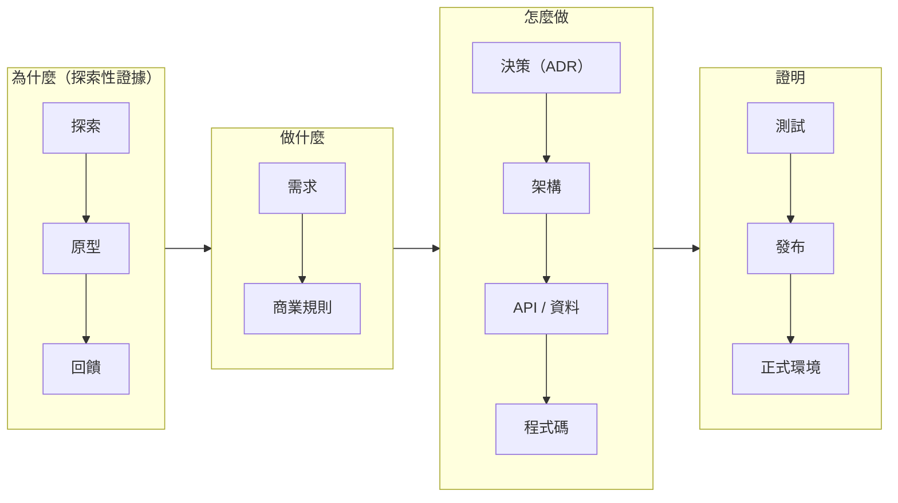

# 可追溯性 Agent（Traceability Agent）

> 維護並回答從「為什麼 → 做什麼 → 怎麼做 → 證明」這條鏈上的問題。

**狀態：** 確定性的部分已實作：`npx kb trace <ID>` 走訪明確的連結，`npx kb build` 組出每個功能的整合頁面（見 [`BUILD.md`](../BUILD.md)）。本規格涵蓋仍需要 AI 的部分：**推論出的**連結（沒有知識 ID 的程式碼、UI 文案、prompt），以及用自然語言回答問題。

---

## 目的

維護橫跨整個生命週期的關係圖：



……並雙向回答可追溯性問題。

## 觸發時機

- 隨時提出的問題（例子見下方）。
- 作為影響分析 Agent 與健康 Agent 的基礎元件。
- 文件或程式碼變更後，更新關係圖。

## 輸入

- 所有文件的 `related` 後設資料（對外的邊）。
- 程式碼註解與測試名稱中的知識 ID 引用（`# knowledge: BR-001`、`test('BR-001: …')`）。
- PR 描述（「相關知識」段落）與發布說明。

## 關係圖

- **節點：** 知識文件（以 `id` 表示）、程式碼路徑、測試、PR、發布版本。
- **邊：** 使用 [`docs/README.md`](../docs/README.md) 中「關係詞彙」定義的 `rel`。只儲存正向邊；Agent 推導出反向邊。
- **邊的來源：** 後設資料（明確、可信）> 程式碼／測試中的 ID 引用（明確、可信）> PR 描述（明確）> AI 推論（**必須標示為 `inferred` 並以提案形式提出，絕不默默加入**）。

## 能回答的問題

| 問題 | 方向 |
|---|---|
| 「如果 BR-012 改了，會影響什麼？」 | 下游 |
| 「程式為什麼這樣做？」／「這條規則從哪裡來？」 | 上游 |
| 「REQ-001 由什麼實作？每個驗收條件都有測試嗎？」 | 下游 + 涵蓋率 |
| 「哪些回饋導致了這個需求？」 | 往上游追到探索 |
| 「1.4 版改了什麼？碰到了哪些規則？」 | 發布 → PR → 知識 |
| 「哪些程式碼依賴已棄用的知識？」 | 孤立檢查 |

## 輸出格式

一棵樹，標示每條連結的邊類型與來源，並標出缺口：

```text
追溯：BR-001（下游）

BR-001  每日推薦規則                                      active · 負責人 PM
├── derived_from ▲ REQ-001  每日商品推薦
│                  └── derived_from ▲ PROTO-003、FB-002、EXP-001
├── decided_by     ADR-001  規則式評分 + LLM 撰寫說明文字
├── implemented_by API-001  GET /stores/{id}/recommendations
│                  └── implemented_in  services/recommendation/api.py
│                                      web/src/features/recommendations/*   （推薦 UI）
├── implemented_in services/recommendation/scoring.py     （RecommendationService）
│                  jobs/daily_recommendations.py
└── verified_by    tests/recommendation/test_scoring.py
                   tests/e2e/recommendations.spec.ts

缺口：
  - BR-001#R6（資料不足）沒有測試引用                             MISSING
  - web/src/features/recommendations/copy.ts 提到「30 天」但沒有知識 ID   （推論連結到 BR-001#R1）
```

`▲` 表示上游（理由）；未標示的分支是下游（依賴者）。

## 規則

- 每個回答都要區分**明確**連結與**推論**連結。
- 探索性節點只以上游*證據*的身分出現——絕不以下游規則的身分出現。
- 缺少的連結以後設資料 diff 的形式提議；不要默默寫進權威文件。
