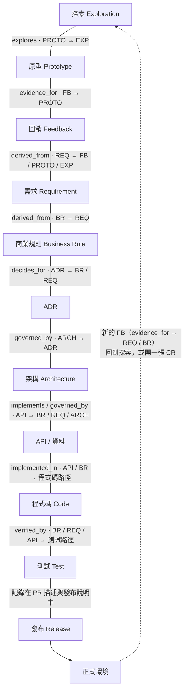
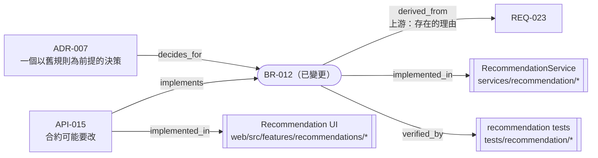

# 知識地圖

這個資料夾是**你的專案的活知識**。一開始是空的（只有這些 README）。[範例專案](../examples/pos-recommendation/README.md)展示了填滿之後的樣子。

---

## 資料夾

| 資料夾 | 內容 | 知識狀態 | 負責人 |
|---|---|---|---|
| [`exploration/`](exploration/README.md) | `EXP` 探索、`PROTO` 原型、`FB` 回饋 | 探索性 | PM |
| [`product/`](product/README.md) | `PROD` 產品背景：願景、使用者、詞彙表 | 權威 | PM |
| [`requirements/`](requirements/README.md) | `REQ` 需求、`CR` 變更申請 | 權威 | PM |
| [`business-rules/`](business-rules/README.md) | `BR` 商業規則 | 權威 | PM |
| [`architecture/`](architecture/README.md) | `ARCH` 架構說明 | 權威 | RD |
| [`decisions/`](decisions/README.md) | `ADR` 架構／技術決策紀錄 | 權威 | 決策者 |
| [`api/`](api/README.md) | `API` API 與資料合約 | 權威 | RD |
| [`operations/`](operations/README.md) | `OPS` 維運手冊、告警、SLO | 權威 | RD / DevOps |
| [`reference/`](reference/README.md) | `REF` 外部參考資料（客戶文件、廠商規格），原文在 `_originals/` | 紀錄性（原文不得更動） | 收件人 |
| [`records/`](records/README.md) | `CLR` 待確認清單、`RPT` 報告（壓測、掃描…） | 紀錄性（結案後封存） | 提問人／產出人 |

**三種知識狀態：** 探索性 = 我們*相信*的；權威 = 我們*決定*的；紀錄性 = 某個時間點*發生*的（收到的、問過的、量測到的）。紀錄性知識是證據：權威文件只能用 `derived_from`／`relates_to` 引用它，就像引用探索性知識一樣；它定稿後以 `kb seal` 封存，之後任何修改都是錯誤。

## 檔案命名

```text
<ID>-<簡短英文-kebab-標題>.md

docs/exploration/EXP-001-pos-ai-recommendations.md
docs/exploration/PROTO-003-dashboard-with-reasons.md
docs/business-rules/BR-001-daily-recommendation-rules.md
docs/decisions/ADR-001-rule-based-recommendation-strategy.md
```

- ID 依前綴循序編號，**永不重複使用、永不更名**。被刪除或被取代的文件永遠保有它的 ID。
- 檔名中的標題可以改，ID 不行。連結一律使用 ID。
- 檔名建議使用英文，以避免工具與 URL 編碼問題；文件內容可使用中文。
- `_build/` 由 `npx kb build` **自動產生**：功能總覽、QA 清單、AI context。它已加入 git ignore。絕不要編輯它；要改就改來源再重新 build。見 [`BUILD.md`](../BUILD.md)。
- 資料夾會被遞迴掃描，所以也可以改成依功能分組（`docs/features/<名稱>/REQ-…`、`BR-…`），而不是依類型。build 和連結的運作方式完全相同。

---

## 關係模型

知識是一張圖，而不是一堆檔案。每份文件在後設資料（`related:`）中宣告它的**對外**連結。Agent 透過掃描所有文件推導出**對內**連結——所以每條關係只寫一次、只寫在一個地方，卻能雙向走訪。

### 正向鏈

每條線都標示連接兩層的關係，以及由哪一方儲存（`來源 → 目標`）。箭頭是閱讀這條鏈的方向；關係一律儲存在標籤所示的來源那一方。



### 關係詞彙

在 `related[].rel` 中只儲存**正向**名稱。反向名稱由推導得出。

| `rel`（儲存在來源文件上） | 意義 | 反向（推導） | 典型用法 |
|---|---|---|---|
| `explores` | 這個原型在測試那個探索 | `explored_by` | PROTO → EXP |
| `evidence_for` | 這則回饋是關於那份文件的證據 | `has_evidence` | FB → PROTO / EXP / REQ |
| `derived_from` | 這份知識源自那份知識 | `derives` | REQ → EXP/PROTO/FB；BR → REQ |
| `decides_for` | 這個決策是為了那個需要而做 | `decided_by` | ADR → REQ / BR |
| `governed_by` | 這個設計遵循那個決策 | `governs` | ARCH / API → ADR |
| `implements` | 這份合約／設計實現了那條規則或需求 | `implemented_by` | API / ARCH → BR / REQ |
| `implemented_in` | 在這個程式碼路徑中實作 | `implements`（程式碼） | BR / API / ARCH → `path:` |
| `verified_by` | 由這個測試驗證 | `verifies` | BR / REQ / API → `path:` |
| `changes` | 這張變更申請修改了那份文件 | `changed_by` | CR → 任何文件 |
| `supersedes` | 這份取代那份（舊的保留，`status: deprecated` 或 `archived`） | `superseded_by` | 任何 → 同類型 |
| `relates_to` | 其他值得知道的關聯 | `relates_to` | 任何 |

連結目標可以是知識 `id:`，或程式碼／測試的 `path:`：

```yaml
related:
  - id: REQ-001
    rel: derived_from
  - id: ADR-001
    rel: governed_by
  - path: services/recommendation/scoring.py
    rel: implemented_in
  - path: tests/recommendation/test_scoring.py
    rel: verified_by
```

### 反向走訪：「如果 BR-012 改了，會影響什麼？」

因為每條邊只存一次、並雙向建立索引，可追溯性 Agent 可以往**下游**走（什麼依賴它？），也可以往**上游**走（它為什麼存在？）。



箭頭表示每條連結儲存在哪一方，Agent 會雙向追蹤。上游回答「我們到底該不該改？」；下游回答「還有什麼要跟著改？」。

### 程式碼與測試反向指回（選用，但成本很低）

```python
# knowledge: BR-012, ADR-007
```

```ts
test('BR-012: excludes discontinued products', ...)
```

這讓 Agent 只要簡單搜尋，就能偵測**偏移**（程式碼改了、文件沒改）與**孤立**（程式碼引用已棄用的規則）。
