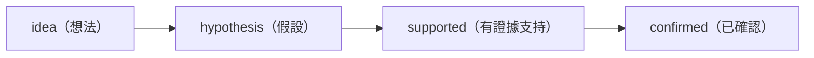

# 探索（Exploration）

**知識狀態：** 探索性 · **負責人：** PM · **ID 前綴：** `EXP`、`PROTO`、`FB`

需求在這裡被*發現*。這裡的一切都允許是錯的、不完整的、或被取代的。這正是重點。

| 類型 | 範本 | 何時建立 |
|---|---|---|
| `EXP` 探索 | [`templates/exploration.md`](../../templates/exploration.md) | 有人有個想法或問題，但還沒人知道要做什麼。 |
| `PROTO` 原型 | [`templates/prototype.md`](../../templates/prototype.md) | 你做了一個東西（HTML、Figma、試算表、簡報）要給人看。 |
| `FB` 回饋 | [`templates/feedback.md`](../../templates/feedback.md) | 有人對原型、發布版本或正式環境行為有所反應。 |

原型的實體檔案（HTML、截圖）可以放在其文件旁邊：

```text
docs/exploration/
  EXP-001-pos-ai-recommendations.md
  PROTO-001-sales-dashboard.md
  PROTO-001/index.html
  FB-001-boss-review-of-proto-001.md
```

## 本資料夾的規則

- **這裡沒有任何東西是商業規則。** 權威文件可以把探索內容當作*證據*引用（`derived_from`），但程式碼與測試絕不能直接依賴它。
- **不要把歷史改掉。** 假設改變時，追加到「演進歷史」；不要改寫過去。
- **回饋是證據，不是決策。** 分開記錄「說了什麼」與「你的詮釋」。
- **封存，不要刪除。** 當探索被確認（升級為 `REQ`）或被放棄時，設為 `status: archived` 並說明原因。

## 狀態與信心程度

探索性文件通常只用 `draft → active → archived`。真正在變動的是 `confidence`：



`confirmed` 的意思是「已由人升級為權威知識」——見 [`WORKFLOW.md`](../../WORKFLOW.md) 的「升級」一節。
