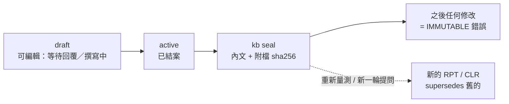

# 紀錄（`CLR` 待確認清單、`RPT` 報告）

**知識狀態：紀錄性（record）· 結案後封存，不再修改**

由我們產出、但描述的是「某個時間點發生了什麼」的文件。它們不是想法（探索性），也不是決策（權威），而是**事件的紀錄**：

| 類型 | ID | 例子 | 何時封存 |
|---|---|---|---|
| 待確認清單 | `CLR` | 給客戶的 API 疑問清單、給老闆的規則確認題 | 每題都有結論（answered / dropped）之後 |
| 報告 | `RPT` | 壓測報告、資安掃描、相容性測試、效能分析 | 定稿之後 |

```text
docs/records/
  CLR-001-customer-x-api-questions.md
  RPT-001-recommendation-load-test.md
  _originals/
    RPT-001/
      k6-summary.json              工具原始輸出（封存時一起雜湊）
```

## 生命週期



## 紀錄如何影響權威知識

紀錄是**證據**，必須經過人才會變成規則：

- **CLR**：每題回答都要「落地」——由負責人更新 API / BR / REQ，並在 `落地到` 欄填上 ID（不需要改任何東西就寫 `none`）。validate 會抓出「已回覆卻沒落地」的題目。
- **RPT**：用 `evidence_for` 指向它驗證的 REQ / ADR / ARCH。若那些文件在量測日（`measured_on`）之後變更，validate 會警告「結果可能已不成立」，提醒你重跑。

範本：[`templates/clarification.md`](../../templates/clarification.md)、[`templates/report.md`](../../templates/report.md)
