# 範例：POS 資料分析 + AI 商品推薦

一個完整且貼近真實的生命週期——從老闆的一句話，到上線後被要求的規則變更——展示知識如何被發現、升級、實作，並保持鮮活。

> 本範例中的程式碼路徑（`services/recommendation/…`、`web/src/…`）僅為示意。重點在於知識文件。

---

## 故事

```mermaid
flowchart TD
    subgraph DISC["探索 — 探索性"]
        A["2026-06-02 · 老闆<br/>「我想要 POS 資料分析和 AI 推薦。」"]
        B["EXP-001<br/>假設：店長需要每天可以直接行動的推薦"]
        C["2026-06-05 · PROTO-001<br/>銷售儀表板 v1（銷售預測圖 + 熱銷商品）"]
        D["2026-06-09 · FB-001<br/>「銷售預測比較不重要，我需要庫存資訊。」"]
        E["2026-06-16 · PROTO-002<br/>以庫存為主：該補貨／庫存過多清單"]
        F["2026-06-19 · FB-002<br/>「我想知道 AI 為什麼推薦這個商品。」"]
        G["2026-06-26 · PROTO-003<br/>附上理由的推薦卡片"]
        H["2026-07-01 · FB-003<br/>「對，就是這個。」（+ 決定試點範圍：3 間門市）"]
        A --> B --> C --> D --> E --> F --> G --> H
    end
    subgraph ENG["工程 — 權威"]
        I["2026-07-15 · REQ-001 每日商品推薦<br/>BR-001 推薦規則"]
        J["2026-07-17 · ADR-001<br/>規則式評分 + LLM 撰寫說明文字"]
        K["2026-07-20 · API-001<br/>GET /stores/{storeId}/recommendations"]
        L["程式碼 → 測試 → 1.0 版發布至 3 間試點門市（2026-08-12）"]
        I --> J --> K --> L
    end
    subgraph CHG["正式環境 → 變更"]
        M["2026-08-26 · FB-004（正式環境）<br/>「它反應太慢了——月餅禮盒都賣完了才叫我補貨。」"]
        N["2026-08-28 · CR-001<br/>老闆：「把推薦區間從 30 天改成 14 天。」"]
        O["2026-09-02 · 決定：附條件核准"]
        P["2026-09-04 · 知識更新<br/>BR-001 v1.1 · REQ-001 v1.1 · API-001 · ADR-001 備註"]
        Q["2026-09-09 · 1.1 版發布"]
        R["2026-09-16 · 健康檢查 → 發現一項待辦"]
        M --> N
        N -->|"影響分析 Agent 發現與最低銷量<br/>規則之間隱藏的交互影響"| O
        O --> P --> Q --> R
    end
    H ==>|"升級 — 需求探索 Agent → 候選版本；<br/>PM 編修並核准"| I
    L --> M
```



## 檔案

| 檔案 | 內容 | 知識狀態 |
|---|---|---|
| [`exploration.md`](exploration.md) | `EXP-001` —— 想法，以及假設如何演進 | 探索性 |
| [`prototype.md`](prototype.md) | `PROTO-001`、`PROTO-002`、`PROTO-003` | 探索性 |
| [`feedback.md`](feedback.md) | `FB-001` … `FB-004`（含正式環境回饋） | 探索性 |
| [`requirement.md`](requirement.md) | `REQ-001` 每日商品推薦 | 權威 |
| [`business-rule.md`](business-rule.md) | `BR-001` 推薦規則 | 權威 |
| [`adr.md`](adr.md) | `ADR-001` 推薦策略 | 權威 |
| [`api.md`](api.md) | `API-001` `/recommendations` | 權威 |
| [`impact-analysis.md`](impact-analysis.md) | `CR-001` + 影響分析 + 知識更新 + 健康檢查 | 權威（決策紀錄） |
| [`_build/`](_build/README.md) | 由 `npx kb build` **自動產生**：[功能總覽](_build/features/REQ-001/overview.md)、[QA 清單](_build/features/REQ-001/qa-checklist.md)、[AI context](_build/features/REQ-001/ai-context.md)、變更紀錄、健康報告 | build 產物 |

> **為了閱讀方便而濃縮。** 在真實的儲存庫中，每筆紀錄都是 `docs/…` 下獨立的檔案（例如 `docs/exploration/FB-002-why-this-product.md`）。這裡包含多筆紀錄的檔案，會用 `yaml` 區塊呈現每筆紀錄的後設資料，而不是 front matter。

## 自己 build 看看

```bash
npx kb build --src examples/pos-recommendation --today 2026-09-16
npx kb trace BR-001 --src examples/pos-recommendation
```

這裡 commit 了 `_build/`，**僅作為樣本**。在真實專案中它會被 git ignore 並重新產生（見 [`BUILD.md`](../../BUILD.md)）。把 [`_build/features/REQ-001/overview.md`](_build/features/REQ-001/overview.md) 和八個來源檔案比較看看：一頁看完，每個段落都連回來源。

## 值得注意的地方

1. **一開始並不存在需求。** 三個原型與三輪回饋產出了它。需求的 `derived_from` 連結，精確指回形塑它的那些回饋。
2. **回饋並沒有自己變成規則。** FB-001 說「要庫存，不要預測」。這代表什麼是由 PM 決定的（EXP-001 演進歷史 v2），之後才寫進 REQ-001 的範圍。
3. **抓到了一個原型假設。** PROTO-003 顯示 5 張卡片，只是「因為剛好塞得進螢幕」。需求探索 Agent 把「最多 5 則」標示為*原型假設*，而不是證據。PM 之後才把它訂為真正的規則，並附上真正的理由（BR-001#R4）。
4. **ADR 有重新檢視條件**，而正式環境的回饋後來觸發了其中一部分。Agent 把這件事記成備註——它並沒有判定 ADR 是錯的。
5. **影響分析發現了人很可能會漏掉的事：** 把區間從 30 天縮短到 14 天、卻維持「區間內至少賣出 5 件」，會悄悄移除大部分*庫存過多*的推薦——因為滯銷品正是那些會掉到門檻以下的商品。
6. **歷史被保留下來。** BR-001 與 REQ-001 顯示 v1.0 → v1.1，並以 CR 作為原因。EXP-001 被封存而非刪除。PROTO-003 仍然寫著「30 天」——這是正確的，因為它是歷史。
7. **build 抓到了一個真實的錯誤。** 這個範例第一次 build 就失敗了：EXP-001 連到一份從未寫過的 `PROD-001`。審查的人很可能看不出來，build 不會漏掉。
