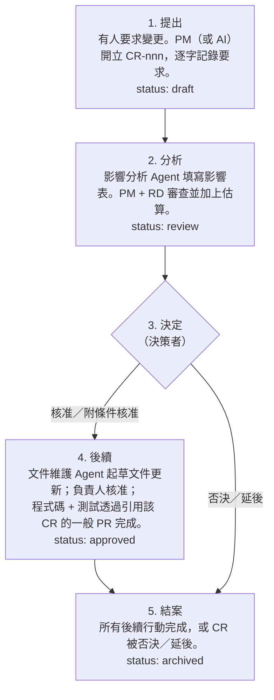

# 變更政策

> **不要試圖阻止變更。讓變更的成本與影響清楚可見。**

老闆和利害關係人會改變範圍。在快速變動的產品中，這很正常。真正的失敗不是變更本身——而是沒人看見成本的變更，以及日後沒人找得到理由的變更。

---

## 什麼時候需要變更申請（CR）？

| 情境 | 需要 CR？ | 改為 |
|---|---|---|
| 仍在探索中（只有 EXP / PROTO / FB） | 否 | 記錄為 `FB`，更新 EXP，迭代原型 |
| 修改**已核准／生效中**的 REQ 範圍、BR、ADR 或 API 合約 | **是** | — |
| 釐清 REQ/BR 的措辭但不改變意思 | 否 | 負責人核准編輯；新增一列變更歷史 |
| 修 bug，讓程式碼符合既有的 BR | 否 | PR 中引用該 BR |
| 不改變行為的重構 | 否 | PR，勾選「無文件影響」 |
| 任何日後可能有人問「這是誰決定的？」的事 | 是 | — |

有疑慮時就寫 CR。一張小 CR 只要 10 分鐘，大部分工作由影響分析 Agent 完成。

## 流程

## 規則

1. **逐字記錄要求**，以及誰提出、何時提出。轉述正是誤解誕生的地方。
2. **先看影響，再做決定。** 決策者在決定之前要看到影響表與估算。小變更的影響表可以只有三行——但一定要有。
3. **「無」要明確寫出。** 每個影響領域都要填寫，即使是「無」。空白代表「沒有分析過」。
4. **決策者要具名。** 常是老闆或 PM。絕不是 AI。
5. **被否決與延後的 CR 要保留。** 它們是「這個我們不是討論過了嗎？」的答案。
6. **更新的文件在變更歷史中引用 CR**，讓每個權威變更都有可追溯的理由。
7. **不要把不相關的變更塞進同一張 CR。** 一張 CR 一個決定。

## 快速通道

決策者、負責人與執行者能直接對話時，可以在一次對話中處理完一張 CR：

> PM：「老闆想把區間改成 14 天。CR-001 已經開了，影響分析也附上了——大約半天工作量，UI 文案和一份 ADR 的備註要改。可以嗎？」
> 老闆：「可以。」
> PM 把決定記錄在 CR-001。完成。

這就是整個流程。價值在於書面紀錄與可見的影響，而不在於儀式。
