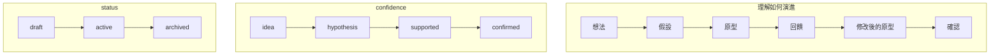
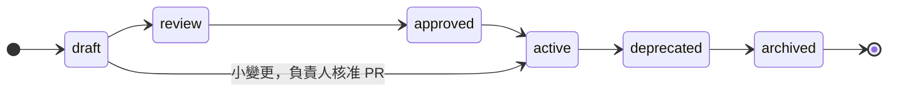
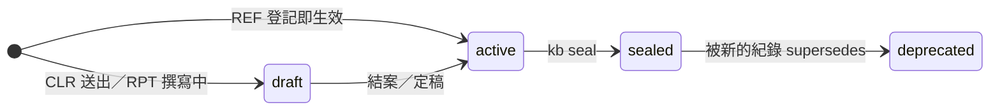
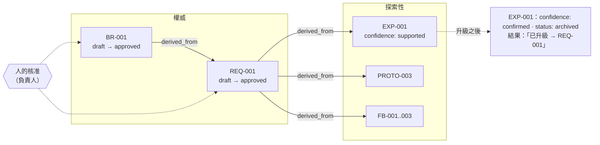
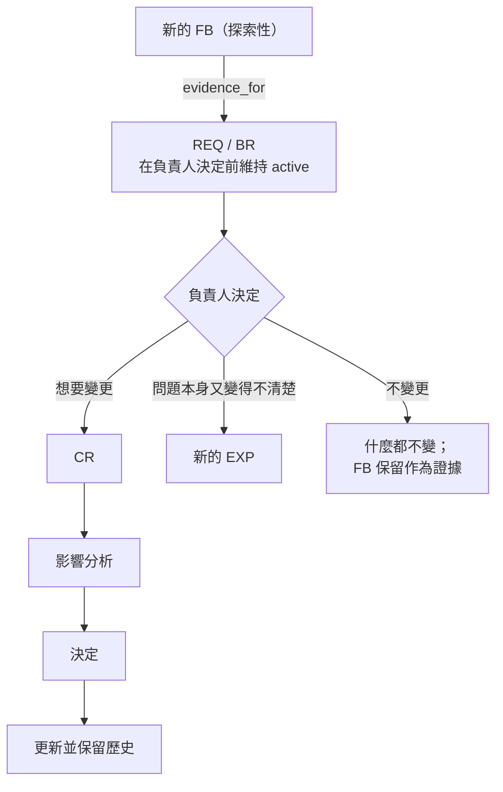

# 知識生命週期

每份文件由兩個互相獨立的維度描述。**不要把它們合在一起。**

| 欄位 | 回答的問題 | 值 |
|---|---|---|
| `knowledge_state` | *我們該多信任它？* | `exploratory`（探索性）、`authoritative`（權威）、`record`（紀錄性） |
| `status` | *這份文件處於生命週期的哪個階段？* | `draft`、`review`、`approved`、`active`、`deprecated`、`archived` |

一份需求草稿是 `authoritative` + `draft`（它是*將會*成為事實的那種文件，只是還沒被核准）。一份進行中的探索是 `exploratory` + `active`（正在使用中，但只是一種看法）。

---

## 探索性知識（Exploratory Knowledge）

仍在被發現中的知識：想法、假設、原型、回饋、未解問題、未經確認的假設、替代概念。

**類型：** `exploration`、`prototype`、`feedback`

**理解透過 `confidence` 演進：**

**特性**

- 可能是錯的，可能被取代。這正是它的功能。
- 永遠不是事實來源（`source_of_truth: none`）。
- 永遠不能成為程式碼或測試的直接依賴。
- 負責人（PM）可自由編輯——不需要核准。
- 演進以只能追加的方式記錄，讓通往需求的路徑保持可見。

## 權威知識（Authoritative Knowledge）

團隊已明確接受為目前事實來源的知識。

**類型：** `product-context`、`requirement`、`change-request`、`business-rule`、`architecture`、`adr`、`api`、`operations`

**透過 `status` 走完生命週期：**

| 狀態 | 意義 | 誰把它移到這裡 |
|---|---|---|
| `draft` | 撰寫中（常由 AI 撰寫） | 任何人 |
| `review` | 準備好交給負責人 | 撰寫者 |
| `approved` | 負責人已接受；尚未生效（例如尚未開發／發布） | 負責人 |
| `active` | 生效中——這就是目前的事實 | 負責人（通常在發布時） |
| `deprecated` | 被取代或不再建議使用；為歷史保留 | 負責人 |
| `archived` | 已結案的紀錄 | 負責人 |

小團隊在小變更時可以跳過 `review` 與 `approved`，在負責人核准 PR 時直接從 `draft` 變成 `active`。唯一永遠不能跳過的步驟是**人類負責人的核准**。

**特性**

- AI 可以提議變更；由負責人核准。
- 核准之後的變更要記錄在變更歷史中（誰、何時、為什麼）。
- 用取代，永不刪除。

## 紀錄性知識（Record Knowledge）

某個時間點**發生過**的事：別人給我們的資料、我們問過的問題與得到的回答、我們量測到的結果。它不是看法（不會「變得更確定」），也不是決定（不是事實來源），而是事件本身。

**類型：** `reference`（REF，外部資料）、`clarification`（CLR，待確認清單）、`report`（RPT，報告）

**特性**

- **定稿後不可變。** `kb seal` 記錄內文（CLR/RPT）與附檔的 sha256；之後的任何修改都是 `IMMUTABLE` 錯誤，build 失敗。REF 在登記當下就封存——我們不是作者，從來沒有「撰寫中」。
- **用取代，不用修改。** 對方給了新版、重新量測、新一輪提問 → 新文件 + `supersedes`。新舊兩份之間的差異本身就是知識。
- **是證據，不是規則。** 權威文件只能用 `derived_from`／`relates_to` 引用它（與探索性知識相同）。程式碼不應依據它實作：客戶文件說了什麼，要先由負責人寫進 API／BR。
- **CLR 的每個回答都要「落地」。** 由負責人更新權威文件，並在問題清單的 `落地到` 欄填上 ID。
- **RPT 會過期。** 它驗證的文件（`evidence_for`）在量測日之後變更，validate 就提醒重跑。
- **不做定期審查。** 紀錄描述的是過去，不會因為時間經過而變得不正確。

---

## 升級：探索性 → 權威

規則：

1. **既有文件的知識狀態永不翻轉。** 升級是建立新的權威文件；探索性文件保留為發現過程的紀錄。
2. **只有人能升級。** AI 可以產出候選版本（見需求探索 Agent），一律是 `status: draft`。
3. **每個被升級的主張都要透過 `derived_from` 引用證據。**
4. **原型的假設預設不會被升級。** 每一個都要明確地被接受進 BR、轉成未解問題，或被捨棄。
5. **必要時可以部分升級。** 把已確認的核心升級為 `REQ-001`，其餘部分繼續在同一份或新的 EXP 中探索，這完全沒問題。

## 降級／重新開啟

權威知識可以被新證據挑戰（通常是正式環境的回饋）。流程是：

在負責人另作決定之前，權威文件維持 `active`。證據本身永遠不會改變它。

---

## 過期（Staleness）

以下任一情況成立時，文件即為**過期**：

- `last_reviewed` 早於 `review_every`（預設：探索性 30d · REQ/BR/API 90d · ARCH/OPS 180d · ADR/CR 不需要）
- 它連結的文件（`derived_from`、`implements`、`governed_by`）在其 `last_reviewed` 之後有變更
- 它連結的程式碼或測試（`implemented_in`、`verified_by`）在其 `last_reviewed` 之後有變更

過期不代表錯誤。它代表「負責人應該看一下」。修正方式常常只是更新 `last_reviewed`。
