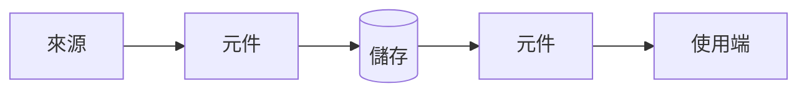

# ARCH-000：<系統或區域名稱>

<!-- 描述系統「現在」的樣子。預計但尚未實作的變更放在明確標示的「規劃中」段落。每個重要選擇都連到解釋它的 ADR。 -->

## 概觀

<!-- 3–5 句：這部分系統做什麼、服務哪個需求、邊界在哪裡。 -->

## 元件

| 元件 | 職責 | 程式碼 | 負責人 |
|---|---|---|---|
| | | `<路徑>` | RD |

## 資料流

<!-- 請替換這張示意圖。建議使用 Mermaid：GitHub 會直接渲染，AI 也能讀懂並更新。
     逐步描述主要流程。註明是批次還是即時。 -->

## 介面

| 介面 | 類型 | 合約 |
|---|---|---|
| | HTTP / 事件 / 檔案 / DB | API-… |

## 效能

<!-- 目標與已知限制。例如「p95 < 300 ms」、「批次在 06:00 前完成」。 -->

## 安全

<!-- 身分驗證／授權、資料敏感度、機密管理、租戶隔離。 -->

## 失效處理

| 失效情境 | 偵測方式 | 行為 | 復原 |
|---|---|---|---|
| | | | OPS-… |

## 擴展性

<!-- 目前負載、預期成長、最先會撐不住的地方。 -->

## 相關 ADR

| ADR | 決策 | 影響 |
|---|---|---|
| ADR-… | | |

## 規劃中（尚未實作）

<!-- 選填。實作完成或放棄後移除。 -->

## 變更歷史

| 日期 | 變更 | 原因 | 核准者 |
|---|---|---|---|
| YYYY-MM-DD | 初版 | REQ-… | RD |
